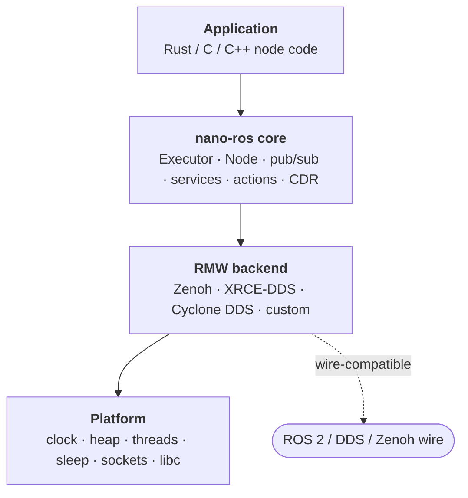

# Introduction

nano-ros is a lightweight ROS 2 client library for embedded real-time systems.
It runs on bare-metal microcontrollers, FreeRTOS, NuttX, ThreadX, and Zephyr,
as well as Linux hosts. The entire core stack is `no_std` compatible.



Four layers, swappable independently: the same node code runs over any RMW
backend on any platform. Here is a complete Linux publisher — register a
backend, open the executor, publish `std_msgs/String` (`Hello World: N`)
on `/chatter` once a second:

```rust
use core::fmt::Write as _;
use nros::prelude::*;
use std_msgs::msg::String as StringMsg;

fn main() {
    // Pick the backend at compile time; this one line registers it.
    nros_rmw_zenoh::register().unwrap();

    let config = ExecutorConfig::new("tcp/127.0.0.1:7447").node_name("talker");
    let mut executor: Executor = Executor::open(&config).unwrap();

    let mut node = executor.create_node("talker").unwrap();
    let publisher = node.create_publisher::<StringMsg>("/chatter").unwrap();

    let mut count = 0i32;
    node.create_timer_repeating(core::time::Duration::from_millis(1000), move || {
        count += 1;
        let mut msg = StringMsg::default();
        let _ = write!(msg.data, "Hello World: {count}");
        publisher.publish(&msg).unwrap();
    })
    .unwrap();

    executor.spin(SpinOptions::default()).unwrap();
    // This is the imperative Layer-2 API; the starters use the
    // declarative `nros::node!` / `nros::main!` form — both are
    // first-class (see Concepts → Two-Layer API).
}
```

The same program in C and C++ is in the First Node guides:
[Rust](../get-started/first-node-rust.md) ·
[C](../get-started/first-node-c.md) ·
[C++](../get-started/first-node-cpp.md).
When a project grows beyond one node, continue with
[Multi-Node Project Layout](../build/growing-your-workspace.md).

## What you get

- **One node, any board.** You write a node once. Moving it to another board
  is one line, the `board =` in the image's `system.toml`. The target triple,
  linker flags, backend and pool sizes all follow from that line, so neither
  your code nor your build files change.
- **Talk to ROS 2 as it is.** Your nodes join a stock ROS 2 graph: over Zenoh
  with `rmw_zenoh_cpp`, or over plain RTPS with `rmw_cyclonedds_cpp`. Topics,
  services and actions work in both directions.
- **Pick the middleware, keep the code.** Zenoh (no agent), XRCE-DDS (agent,
  micro-ROS compatible) or Cyclone DDS (RTPS). Switching is one line in
  `system.toml`, then build again.
- **Fits a microcontroller.** The core is `no_std`, with the `alloc` and
  `std` features opt-in, and runs on a bare-metal Cortex-M3. Whether your
  image needs an allocator depends on the backend you choose: [Choosing an RMW Backend](../communicate/choosing-an-rmw.md)
  says which does.
- **Rust, C or C++.** The core is Rust, with C and C++ APIs over it; the C
  API follows rclc conventions. One workspace can mix all three.
- **No ROS 2 install to build.** Message bindings come from interface
  definitions the release bundles. You need ROS 2 only to run against a ROS 2
  graph.
- **Real-time you can reason about.** Fixed-size pools sized at build time,
  plus scheduling and safety features for RTOS targets: see
  [Real-Time and Safety](../realtime/rtos-cooperation.md).
- **Checked, not only tested.** Serialization, scheduling and the safety
  protocol are covered by model checking and machine-checked proofs, and
  every example is held identical across platforms by a test.

## Does it work on the board I have?

Each board's support status, where it runs (host, emulator or hardware) and
how often it is checked come from the board registry, and the book shows them
on generated pages: [Supported Boards](../reference/supported-boards.md) lists
every board, [Board support levels](../reference/board-support-levels.md)
says what each status means, and each board has its own evidence page.
`nros board list` and `nros board show <board>` print the same facts from the
`nros` you installed.

A board that is not in the registry can still run nano-ros through the
customization ladder: the [out-of-tree STM32F4 worked
example](../extending/stm32f4-out-of-tree.md) shows the pattern, and the PX4
module template brings nano-ros into PX4 firmware as an external module
([PX4](../targets/px4.md); C++ only, because PX4's uORB binding is
C++-only). MPS2-AN385 bare-metal is Rust-only: the C and C++ APIs need an
RTOS for libc and a heap.

The ESP32 (both the ESP-IDF component and the esp-hal bare-metal board) is
retired: [ESP32 — retired](../migrating/esp32.md).

## Supported platforms (by RTOS)

| Platform   | RTOS          | Network Stack  | Targets                      |
|------------|---------------|----------------|------------------------------|
| POSIX      | Linux         | OS sockets     | x86-64, aarch64              |
| Bare-metal | None          | smoltcp        | Cortex-M3                    |
| FreeRTOS   | FreeRTOS      | lwIP           | Cortex-M3 (QEMU)             |
| NuttX      | NuttX         | BSD sockets    | Cortex-A7 (QEMU), RISC-V32 (QEMU rv-virt) |
| ThreadX    | ThreadX       | NetX Duo       | RISC-V 64 (QEMU), Linux sim  |
| Zephyr     | Zephyr        | Zephyr sockets | Various boards               |

`posix` there is the *platform* layer, which is genuinely POSIX-clean. The
host *board* is named `linux`, and that is the narrower claim: only Linux is
tested, and `nros-board-linux::apply_tier_affinity` calls `sched_setaffinity`
with `cpu_set_t`, which libc does not define for macOS. **macOS is not
supported**.

## RMW Backends

nano-ros supports several middleware backends, selected at compile
time by naming one in `system.toml`:

- **Zenoh** (`nros-rmw-zenoh`) — peer-to-peer via zenoh-pico. No agent
  process. Compatible with ROS 2 `rmw_zenoh_cpp`.
- **XRCE-DDS** (`nros-rmw-xrce-cffi`) — agent-based via Micro-XRCE-DDS.
  Compatible with micro-ROS agent.
- **Cyclone DDS** (`nros-rmw-cyclonedds`) — C++ shim; full RTPS wire-compat
  with stock `rmw_cyclonedds_cpp`.

Application code is identical regardless of backend — switching is editing
`[system] rmw` and building again. (Zephyr keeps Kconfig as its own
front-end, as it does for every other build knob.)

## Project Status

nano-ros is under active development. Core capabilities are functional and
exercised in CI; see the platform chapters for per-target detail.

| Capability       | Status   |
|------------------|----------|
| Pub/Sub          | Complete |
| Services         | Complete |
| Actions          | Complete |
| Parameters       | Complete |
| ROS 2 interop    | Complete |
| Zenoh backend    | Complete |
| XRCE-DDS backend | Complete |
| Cyclone DDS backend | Complete (native + embedded; some embedded action paths in progress) |
| Zephyr support   | Complete |
| QEMU bare-metal  | Complete |
| C API            | Complete |
| C++ API          | Complete |
| Message codegen  | Complete |

## How This Book Is Organized

- **Get Started:** install, build and run your first project.
- **Build a Project:** workspace layout, messages, configuration, build
  profiles.
- **Run on a Target:** `nros run`, and each platform's setup.
- **Communicate:** choosing a backend, QoS, ROS 2 interop, transports.
- **Real-Time and Safety:** execution model, scheduling, static memory,
  production readiness.
- **Operate and Debug:** logging, time, diagnostics.
- **Concepts and Rationale:** why nano-ros is shaped the way it is.
- **Extending nano-ros:** add a board, a platform or an RMW backend from
  outside the tree.
- **Reference:** the CLI, APIs, boards, configuration.
- **Migrating:** moving from an older release.

Changing nano-ros itself is a different job, with its own book:
[nano-ros Internals](../internals/orientation/start-here.html).
